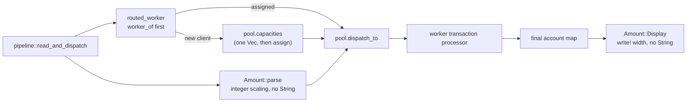

## Context

The streaming path is `pipeline::read_and_dispatch` -> `ClientDispatcher` -> `WorkerPool::dispatch_to`, with `Amount::parse` at ingestion and `Amount::Display` at final account rendering. Two hot-path allocations remain:

- Every successfully parsed transaction calls `pool.capacities()`, which allocates a `Vec<usize>`, even when the client is already pinned to a worker.
- Every fractional amount builds a padded `String` during parsing, and every rendered account builds a `format!("{fraction:04}")` `String`.

The existing behavior is guarded by 87 cargo tests and 76 acceptance scenarios. In-force ADRs 0001 (fixed worker pool), 0002 (fixed-point money), and 0003 (single-pass streaming) remain in force and are unaffected.

### Component / data-flow view



## Goals / Non-Goals

**Goals:**

- Avoid the per-transaction capacity vector for clients already assigned to a worker.
- Avoid heap allocation in non-empty fractional amount parsing and in amount rendering.
- Preserve every accepted/rejected input, error variant/payload, ledger result, and output byte.
- Keep the dispatcher and amount public APIs unchanged.
- Add executable-spec coverage for leading-dot and bare-dot forms without changing behavior.

**Non-Goals:**

- Benchmark harness, CI allocation gate, or allocator instrumentation.
- Changing worker-pool behavior, reader API, queue capacity, or sampling semantics.
- Error-payload allocation changes (`input.to_string()` remains on error paths).
- Library re-exports, private implementation modules, broader docs, or Account hold/release tests; those are deferred.
- Floating point, new dependencies, or output ordering changes.

## Decisions

### D1. Lazy capacities at the pipeline call site

Add a private routing helper in `pipeline`:

```text
routed_worker(dispatcher, client, capacity_supplier):
    match dispatcher.worker_of(client):
        Some(worker) -> worker
        None -> dispatcher.worker_for(client, &capacity_supplier())
```

`read_and_dispatch` calls `routed_worker(..., || pool.capacities())`. `ClientDispatcher` keeps its existing public methods and assignment policy unchanged: fewest assigned clients, then greatest remaining capacity, then the round-robin cursor.

- **Rationale:** The allocation is made by the caller, so the fast path must live at the call site. A lazy supplier is a testable seam: a test can assert it is not invoked for a pinned client and invoked exactly once for a new client. New clients pay one extra `worker_of` lookup, which is negligible compared with the avoided allocation.
- **Alternatives:** Change `ClientDispatcher` to accept a supplier (rejected: changes the dispatcher API and couples routing to capacities); add a dispatcher `assign`/`assigned_worker` split (rejected: unnecessary API churn when `worker_of` and `worker_for` already exist).

### D2. Allocation-free fraction parsing

Keep the current validation order and error payloads, then replace the padded string with arithmetic:

```text
whole_scaled = whole.checked_mul(SCALE).ok_or(Overflow)?
fraction_scaled = if fraction is empty { 0 } else {
    let value: i64 = fraction.parse().map_err(|_| Overflow)?;
    value.checked_mul(10_i64.pow((4 - fraction.len()) as u32))
         .ok_or(Overflow)?
}
scaled = whole_scaled.checked_add(fraction_scaled).ok_or(Overflow)?
```

Preserved behavior:

- Trim surrounding whitespace; reject empty, leading `-` (`NegativeAmount`), leading `+` (`InvalidAmount`).
- Reject a second decimal point, mixed text, and non-ASCII digits (`InvalidAmount`).
- Reject more than four fraction digits (`TooManyDecimals`).
- Preserve accepted edge forms: `1.`, `00.5`, `0.0000`, `.5`, `.25`, `.0001`.
- Preserve original untrimmed input in error payloads.
- Preserve error precedence: empty/negative/plus, structural checks, decimal-length, then scaling overflow (`Overflow`, not `InvalidAmount`).
- Boundary: `922337203685477.5807` is accepted; `922337203685477.5808` is `Overflow`.

- **Rationale:** The current padded `String` is unnecessary; `10^(4-len)` gives the same scale. Checked operations preserve overflow handling. No new error variants.
- **Alternatives:** Keep the `String` (rejected: the allocation being removed); parse the fraction digit-by-digit with a loop (also allocation-free but more code and more places to lose the checked-overflow behavior).

### D3. Allocation-free canonical rendering

Render directly with `write!`:

```text
negative = value < 0
magnitude = value.unsigned_abs()
whole = magnitude / SCALE as u64
fraction = magnitude % SCALE as u64

if fraction == 0: write sign + whole + ".0"
else:
    digits = 4
    while digits > 1 and fraction % 10 == 0:
        fraction /= 10
        digits -= 1
    write sign + whole + "." + fraction zero-padded to width digits
```

- **Rationale:** `unsigned_abs` handles `i64::MIN` without overflow. Stripping zeros before zero-padding is required: `fraction = 10` must become `001` at width 3 (`0.001`), not `010`. `% 10` avoids an MSRV question around `is_multiple_of`.
- **Alternatives:** Keep `format!` (rejected: allocation); use a fixed four-digit write and trim (rejected: `Formatter` cannot retract written bytes).

### D4. Regression coverage and spec delta

Unit tests:

- Dispatcher seam: pinned client does not call the capacity supplier; a new client calls it once; assignment policy remains unchanged (existing pinning test stays).
- Parse: `.25`, `.0001`, `1.`, `00.5`, `0.0000`, bare `.`, `+1`, multiple dots, >4 digits, negative, boundary overflow, and error precedence/payloads.
- Render: `0`, `±1`, `±10`, `±100`, `±1000`, `±10000`, `±1203`, `i64::MIN`, `i64::MAX`.

Acceptance delta: full MODIFIED blocks for **Amounts are stored as scaled integers** and **Invalid amounts are rejected**, preserving every existing scenario and adding `.25`, `.0001`, and bare `.` scenarios. The effective-spec runner replaces the base rules with these copies, so every existing scenario must be present verbatim. The new scenarios are green on the baseline before code changes.

- **Rationale:** The spec delta records executable coverage for edge forms while the unit vectors protect the rewrite's boundaries.
- **Alternatives:** Rely only on existing `0.0001`/`.5` scenarios (rejected: the new parsing paths deserve explicit coverage); add property testing (deferred: no new dev dependency).

## Risks / Trade-offs

- **Parse validation order changes** -> preserve the exact order and add precedence/payload tests.
- **Rendering interior-zero fractions or `i64::MIN` changes bytes** -> strip before padding, use `unsigned_abs`, and test boundary vectors.
- **The fast path still allocates** -> the helper branches on `worker_of` before invoking the supplier; the unit seam proves the supplier is skipped.
- **MODIFIED spec copies omit an existing scenario** -> copy each rule block completely and verify the effective suite scenario count.
- **No allocation benchmark** -> the change is justified by construction and unit seams; throughput measurement is explicitly out of scope.
- **Extra lookup for new clients** -> only first-sight clients pay it; assigned clients avoid both the lookup result allocation and capacity snapshot.

## Migration Plan

No data or output migration. Add the spec delta first, run the effective acceptance suite on the baseline, commit the specs zone, then change `src/amount.rs` and `src/pipeline.rs`, add unit regressions, and keep the effective suite plus CSV regressions green. Rollback reverts the code and the spec delta.

## Open Questions

- The current parser accepts `1.`, `00.5`, and `0.0000`; this design preserves them. Treat them as intentional accepted forms unless the product contract says otherwise.
- No benchmark or CI allocation gate is added; the allocation-free claim is structural and covered by the lazy-capacity seam plus code review.
- ADR-0002 already requires fixed-point arithmetic without floating point; this change does not revisit it, so no superseding ADR is expected.
