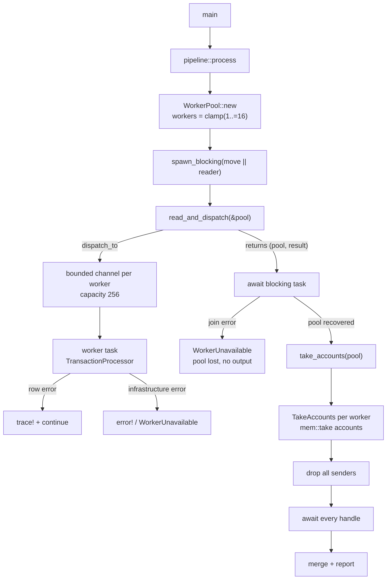

## Context

`WorkerPool` currently exposes a public module, a public `Command` enum, a public `QUEUE_CAPACITY`, and sender accessors (`senders`, `sender`, `send_blocking`). `pipeline` obtains a cloned sender vector and dispatches rows itself. `take_accounts(mut self)` sends a `Snapshot` command, clones each worker's account map, then sends `Shutdown` and joins the handles. The pool is already non-`Clone` and already uses bounded `mpsc::channel(256)`.

In-force ADRs 0001 (fixed worker-pool sharding), 0002 (fixed-point money), and 0003 (single-pass streaming with bounded queues and producer-before-collection) constrain the design. This change stays inside the worker/pipeline boundary and does not alter sharding, money, ledger rules, or output.

### Component / data-flow view

## Goals / Non-Goals

**Goals:**

- Make the pool a crate-private component whose senders, command set, capacity, and lifecycle do not escape.
- Make account collection a single consuming operation that cannot be followed by dispatch.
- Guarantee cleanup on every drain path: senders are dropped and handles are awaited even after a send/reply failure.
- Preserve bounded queues, backpressure, row-skip behavior, and output exactly.
- Keep ADR-0003's terminal mechanism: collect, close senders, join.

**Non-Goals:**

- Changing queue capacity, sharding policy, worker-local state, or the transaction index.
- Changing account arithmetic, overflow behavior, or `TransactionProcessor::snapshot`.
- Making worker loss CLI-inducible or changing acceptance scenarios for valid input.
- Adding a new capability or an engine module.

## Decisions

### D1. Pool owns a narrow crate-private API

Demote `pub mod worker_pool` to `pub(crate) mod worker_pool`; make `WorkerPool` `pub(crate)`, `Command` private, and `QUEUE_CAPACITY` private. Expose `worker_count`, `capacities`, `dispatch_to`, and `take_accounts`. `WorkerPool::new()` owns the count policy (`available_parallelism().clamp(1, 16)`), and a crate-visible `with_worker_count` exists for deterministic tests.

- **Rationale:** The pool is an internal runtime detail; `pipeline` should not know about commands or sender clones. Centralizing count policy removes a second copy of the bound.
- **Alternatives:** Keep the module public and mark individual items `pub(crate)` (rejected: leaves a misleading public module); keep `spawn(usize)` and the clamp in `pipeline` (workable, but splits pool policy).

### D2. Producer owns the pool through `spawn_blocking` and returns it

`pipeline::process` moves the pool into the blocking closure. `read_and_dispatch(&pool)` borrows it for dispatch, and the closure returns `(WorkerPool, Result<(), ProcessingError>)`. The async side awaits the join handle:

- `Ok((pool, dispatch_result))` → call `pool.take_accounts()` even when `dispatch_result` is `Err`, so cleanup still happens; return the dispatch error first, matching current error precedence.
- `Err(join_error)` → the pool was dropped with the panicking task, workers exit on channel closure, return `WorkerUnavailable` and write no accounts output.

- **Rationale:** `spawn_blocking` requires `'static`, so borrowing the pool is impossible. Returning it preserves the producer-before-collection rule and avoids an `Arc`/`Mutex` escape hatch.
- **Alternatives:** `Arc<WorkerPool>` with a `dispatch_to(&self)` (rejected: reintroduces shared ownership and doesn't solve consuming drain cleanly); keep a cloned sender vector (rejected: the API leak being removed).

### D3. `TakeAccounts` is terminal in the worker loop

`Command` becomes `Process(Transaction)` and `TakeAccounts(oneshot::Sender<HashMap<ClientId, Account>>)`. On `TakeAccounts`, the worker replies with `processor.take_accounts()` and breaks out of its loop. No command is processed after accounts are taken.

- **Rationale:** A worker that keeps running with an empty account map can silently lose rows or apply disputes against stale entries. Terminal handling makes the drain one-shot at the worker boundary too.
- **Alternatives:** Reply and continue (rejected: creates the post-take mutation hazard); send accounts without breaking and rely on sender drop (less explicit and harder to test).

### D4. Processor exposes a consuming account drain

Add `pub(crate) fn take_accounts(&mut self) -> HashMap<ClientId, Account>` to `TransactionProcessor`, implemented with `std::mem::take(&mut self.accounts)`. Keep the existing public `snapshot()` unchanged.

- **Rationale:** `accounts` is private to the processor; `worker_pool` needs an owned map to avoid cloning every client. Keeping `snapshot()` avoids an unrelated public break.
- **Alternatives:** Make the field `pub(crate)` (rejected: leaks representation); remove `snapshot()` (deferred; it is a separate API decision).

### D5. Drain always closes senders and joins

`take_accounts(mut self)` destructures the pool, requests `TakeAccounts` from every worker, records the first error, drops all senders, then awaits every handle. It returns the first error if any, otherwise the merged map. A handle `JoinError` is recorded as `WorkerUnavailable`; a send/reply failure is also `WorkerUnavailable`. Collected accounts from healthy workers are discarded if the drain fails, because partial output is forbidden.

- **Rationale:** Early return on the first error would leave other workers running and skip cleanup. A single first-error slot keeps the error path deterministic while still draining everything.
- **Alternatives:** Return immediately on error (rejected: leaks tasks and weakens lifecycle guarantees); return a partial map with a warning (rejected: violates no-partial-output).

### D6. Preserve failure classification and error precedence

Row-level CSV, validation, and invalid-transition failures are logged at `trace!` and skipped by the worker. A closed dispatch channel, failed `TakeAccounts` send/reply, or worker join failure is `WorkerUnavailable`, which is non-recoverable. `pipeline` returns a dispatch error before a drain error, as today.

- **Rationale:** The contract distinguishes skippable row failures from infrastructure failure; preserving the ordering prevents a refactor from changing which error a run reports.
- **Alternatives:** Treat channel loss as a row skip (rejected: silently missing accounts); ignore join errors (rejected: hides worker panics).

### D7. Deterministic tests use module seams, not public leakage

Tests remain in the `worker_pool` module, where private fields are visible:

- Closed channel: construct a pool from a sender whose receiver was dropped; `dispatch_to` returns `WorkerUnavailable`.
- Backpressure: fill a one-slot queue, spawn a `std::thread` that signals it is about to call `dispatch_to`, assert the thread has not finished, drain one command, then join. No sleep-based race.
- Drain: process a deposit, call `take_accounts`, assert the account map and that the worker has exited.
- Rejected row: dispatch a rejected row followed by a valid row and assert the valid one still lands.
- Join failure: construct a pool with a deliberately panicking task handle and assert `WorkerUnavailable`.

- **Rationale:** `blocking_send` must not run on an async test thread, and the public surface cannot induce channel closure. Module seams are the smallest honest test mechanism.
- **Alternatives:** Add a test-only public `try_dispatch` (rejected: broadens the API for tests); sleep-based timing (rejected: flaky).

### D8. `dispatch_to` is blocking-only

`dispatch_to(worker, transaction) -> Result<(), ProcessingError>` uses `blocking_send`, returns `WorkerUnavailable` on a closed channel, and panics if `worker` is out of range because that is a programming error, not a runtime condition.

- **Rationale:** The producer runs on `spawn_blocking`, so blocking is legal there; an invalid index is an internal invariant violation.
- **Alternatives:** Return an error for an invalid index (would misclassify a bug as infrastructure failure); rename to `dispatch_blocking_to` (possible, but the caller context already makes blocking explicit).

## Risks / Trade-offs

- **`spawn_blocking` ownership restructuring can drop the pool on an error path** → the closure returns `(pool, result)` and the caller drains whenever the join succeeds; tests cover dispatch failure plus successful drain.
- **A panicking producer loses the pool before drain** → treat as `WorkerUnavailable`, emit no partial output, and rely on channel closure for task cleanup.
- **Worker termination ordering is easy to get wrong** → `TakeAccounts` replies and breaks; the drain always drops senders and joins.
- **Join-error policy is stricter than today** → document and test that a worker panic fails the run; this aligns with the infrastructure-failure contract.
- **Backpressure tests can become timing-dependent** → use a start signal and the fact that a blocked thread cannot finish, not a sleep.
- **Demoting the module is a library API break** → the pool has no in-repository consumers outside `pipeline` and tests; note it in the proposal.
- **README may name removed commands** → review and update only the affected architecture text.

## Migration Plan

No data or output migration. Change the module visibility, pool command set, processor drain, and pipeline ownership together. Verify with unit tests, integration tests, acceptance scenarios, the CSV regression script, clippy, and fmt. Rollback is a source revert.

## Open Questions

- `TransactionProcessor::snapshot()` is retained for now. If it becomes unused, removing it should be a separate, explicit public-API decision.
- ADR-0003 already states: collect accounts, close the senders, and join the workers. This design moves the map instead of cloning it but follows that sequence, so no superseding ADR is expected; the adr step should record that rationale.
