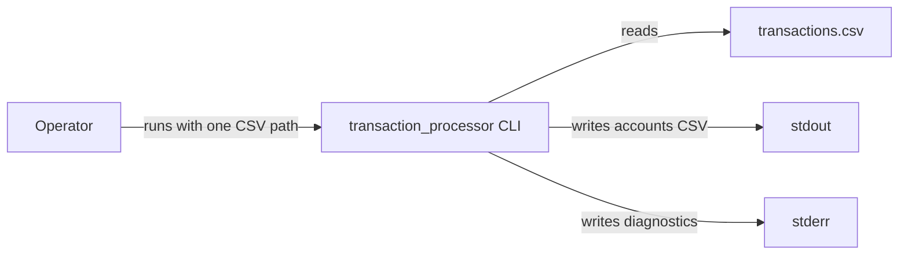
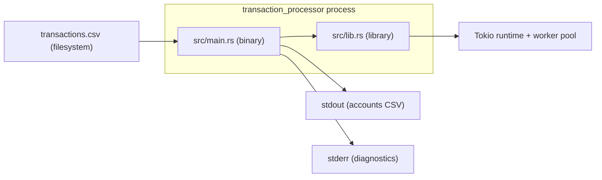
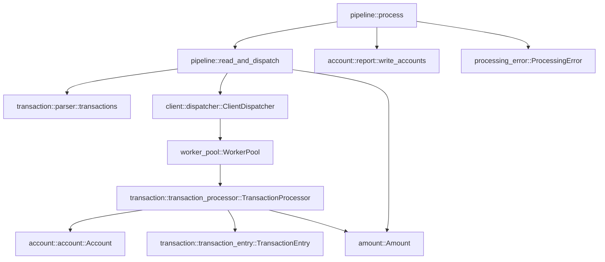
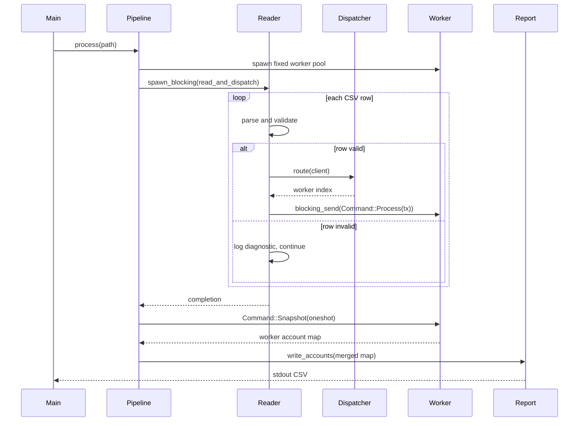

## Context

The repository is greenfield: `SPEC.md` and `README.md` define the contract, and the change adds the first `Cargo.toml`, `src/` tree, and `tests/`. There is no existing `adr/` directory, so no prior decisions constrain this design.

The system is a single Rust package with a shared library crate (`src/lib.rs`) and a thin binary (`src/main.rs`). It streams a chronological transaction CSV, applies deposits, withdrawals, disputes, resolves, and chargebacks to per-client accounts, and writes the final account state to stdout. Money is `i64` scaled by 10,000, and floating point is excluded. The process must stay isolated from per-row failures and keep stdout reserved for the accounts CSV.

Diagram conventions: this design uses plain Mermaid (matching the README), with lightweight C4-inspired levels rather than strict C4. The system is small enough that a context, container, component, and one dynamic sequence cover the architecture; code-level diagrams add little.

### System context

### Container view

### Component view

### Dynamic view

## Goals / Non-Goals

**Goals:**

- Deliver the streaming CLI contract: `cargo run -- transactions.csv > accounts.csv`.
- Keep every domain type and rule in the library so the binary is thin and future variants can reuse the core.
- Preserve per-client transaction order and isolate per-row failures without panics, stream halts, or cross-client corruption.
- Keep only bounded work in flight while streaming the input.
- Prove behaviour with unit tests, an independent oracle, and executable specs.

**Non-Goals:**

- Distributed, network, database, gRPC, WebSocket, or HTTP variants.
- Reading from stdin or accepting an output-path argument.
- A literal O(1) ledger-memory bound; dispute history is inherently proportional to accepted transactions.
- Global duplicate-`tx` detection across worker shards.
- Distinguishing a foreign transaction from an unknown one without a global ownership index.

## Decisions

### D1. One package, library-first

Use one Cargo package whose library holds all logic and whose binary wires the CLI.

- **Rationale:** The spec requires reuse by a future distributed variant, and no `[[bin]]` override is needed because a package with `src/main.rs` exposes a default binary.
- **Alternatives:** A binary-only crate (no reuse); a workspace split (unnecessary overhead).

### D2. Fixed worker pool over per-client actors

Partition clients across a fixed pool of Tokio tasks, each owning `HashMap<ClientId, Account>` and `HashMap<TransactionId, TransactionEntry>`. Dispatch through `tokio::sync::mpsc` with `QUEUE_CAPACITY = 256` and `blocking_send`.

- **Rationale:** The spec allows a sharded pool; it bounds task count and memory while preserving per-client isolation. Worker-local state means no locks on accounts.
- **Alternatives:** One actor per client (up to 65,536 tasks); a shared `DashMap` (locks, contention); a single-threaded loop (no parallelism).

### D3. Reader on a blocking task

Run CSV ingestion in `spawn_blocking` so `blocking_send` is legal, while workers are async tasks.

- **Rationale:** `blocking_send` panics inside an async execution context. A blocking task makes backpressure simple and correct.
- **Alternatives:** `send().await` in an async producer (also valid, but couples parsing throughput to async scheduling); a plain OS thread with `std::sync::mpsc` (drops the configured Tokio channel contract).

### D4. Load-balanced, pinned client assignment

Assign a new client to the worker with the fewest assigned clients, then the most queue capacity, then round-robin; pin the client permanently.

- **Rationale:** Spreading clients avoids a hot shard from queue-capacity tie-breaking alone, and pinning preserves per-client order.
- **Alternatives:** `client_id % worker_count` (simpler and state-free, but can cluster); a central rebalance (violates pinning/order).

### D5. Snapshot-then-shutdown lifecycle

After the reader completes, send `Command::Snapshot(oneshot)` to every worker, await the snapshots, drop the senders (or send `Command::Shutdown`), then join the worker tasks.

- **Rationale:** The reader cannot return row errors on a bounded channel, so no deadlock exists; draining before shutdown avoids losing state.
- **Alternatives:** Workers write stdout directly (interleaved rows, header duplication); workers exit on channel close and hand state back through `JoinHandle` (ownership handoff is awkward).

### D6. `Amount(i64)` with checked arithmetic

Represent money as a newtype over `i64` scaled by 10,000, with strict parsing, canonical rendering, and checked `credit`/`debit`/`hold`/`release` operations.

- **Rationale:** The spec forbids floating point and mandates this scale; a newtype prevents mixing amounts with IDs.
- **Alternatives:** A decimal crate (valid but unnecessary and slower); raw `i64` everywhere (easy to mix with IDs).

### D7. Enum state inside `TransactionEntry`

Store `{ amount, kind, state: Settled | Disputed }` in one `HashMap<TransactionId, TransactionEntry>`; `dispute` and `resolve` rewrite the slot, and `chargeback` removes it.

- **Rationale:** Uniform entry size, no per-transition allocation, exhaustive matches, and in-place transitions suit a shared historical index.
- **Alternatives:** Typestate (illegal states unrepresentable but heterogeneous map and reallocation per transition); `Box<dyn State>` (heap and indirection per entry).

### D8. Literal dispute semantics

Disputes may target any accepted monetary transaction (deposit or withdrawal), may overdraw `available`, and a resolved transaction may be disputed again.

- **Rationale:** Spec §5.5 defines only two rejection reasons (unknown `tx`, already disputed) and states the balance effects unconditionally; the README records the resulting assumptions.
- **Alternatives:** Deposits-only disputes (avoids holding funds never credited); reject when `available < amount` (more conservative but contradicts the literal effects); reject re-dispute after resolve (requires a third state). These remain documented alternatives rather than behaviour.

### D9. Worker-local ownership; foreign references are unknown

A `tx` absent from the worker's index, including a transaction owned by another client, is rejected without mutation. No global ownership map is added.

- **Rationale:** A global map would duplicate the index in the producer and undermine sharding for a diagnostic-only difference.
- **Alternatives:** A producer-side `HashMap<TransactionId, ClientId>` for `NotOwner` (extra O(accepted transactions) memory); broadcasting ownership queries (latency and complexity).

### D10. Duplicate `tx` rejected within a worker

If `tx` already exists in the worker's index, the row is skipped without mutation. Cross-shard duplicates rely on the global-uniqueness invariant.

- **Rationale:** Duplicates violate the spec's uniqueness invariant, but skipping is safer than overwriting history for future disputes.
- **Alternatives:** Overwrite (loses the original amount/state); global dedupe (costly). Cross-client collisions are out of scope per the invariant.

### D11. Initialize clients on first parsed row

Create a zeroed account once a row's type, client, `tx`, and amount presence are valid, before domain validation. Rows rejected during parsing do not create accounts.

- **Rationale:** Matches the README assumption and makes the output set deterministic for rejected domain operations.
- **Alternatives:** Initialize only on successful mutation (drops zeroed clients, contradicting the README).

### D12. Recoverable row errors vs fatal infrastructure errors

`ProcessingError` distinguishes row errors (skipped and logged) from infrastructure errors (I/O, CSV reader, worker channel/join), which propagate out of `process`.

- **Rationale:** Keeps the stream alive for bad rows while never emitting silently incomplete output for infrastructure failure.
- **Alternatives:** Abort on any error (violates isolation); swallow infrastructure errors (corrupt/partial output).

### D13. Tracing with a release cutoff

Use `tracing` + `tracing-subscriber` with `EnvFilter`; default to `warn`, log skipped rows at `debug`/`trace`, and compile trace out of release builds with `release_max_level_info`.

- **Rationale:** Keeps stdout clean, makes diagnostics opt-in, and satisfies the production-trace constraint.
- **Alternatives:** `log` + `env_logger` (runtime-only filtering, harder to guarantee the release cutoff).

### D14. Merge then report

Merge the disjoint worker account maps, optionally sort by client (order is unspecified), and write the header plus rows through an `impl Write` sink.

- **Rationale:** One writer yields a single header and deterministic testing; disjoint keys make merging lock-free.
- **Alternatives:** Never merge and write per worker (duplicate headers, harder tests); force a stable global order (unnecessary).

## Risks / Trade-offs

- **SPEC O(1) memory vs dispute history** → Document the deviation; the transaction index grows with accepted transactions while the input stream stays bounded.
- **Disputes on withdrawals are surprising** → Document the literal assumption and keep deposits-only as the named alternative; revisit if a grader expects otherwise.
- **Hot-client shard limits throughput** → Per-client order requires pinning; accept head-of-line blocking for the hottest client.
- **Dispatcher state grows with clients** → Bounded by 65,536 clients; acceptable.
- **Cross-client diagnostics are lost** → `UnknownTx` may stand in for `NotOwner`; document and update the README wording.
- **Cross-shard duplicate `tx` is undetected** → Rely on the spec's global-uniqueness invariant; note the limitation.
- **Release trace cutoff hides production detail** → Keep infrastructure errors at `error`/`warn`; trace remains available in dev/test.
- **Timing-sensitive tests** → Compare final account state, not interleaving or queue contents.
- **`blocking_send` panics if misused** → Keep the caller on `spawn_blocking`; add a unit test that the reader path never runs on an async worker.

## Migration Plan

Greenfield, so there is no data migration and no persisted state. Rollout is a single change: create the package, implement the library, add the thin CLI, and land tests. Rollback is reverting the change; no external state is affected. Delivery sanitizes `src/`, Cargo files, `tests/`, and `README.md` per the project delivery list and removes any company or challenge references.

## Open Questions

- **Acceptance runner stack:** `openspec/config.yaml` has no `stack:` value. The spec-as-source tasks require choosing `javascript` (cucumber-js) or `python` (behave) before scaffolding `acceptance-tests/`.
- **Withdrawal disputes:** Confirm that the literal reading (withdrawals are disputable) is intended, or switch to deposits-only before implementation.
- **Committed fixtures:** The README commits synthetic `tests/transactions*.csv`; the project rule forbids committing sample or production input CSVs. Confirm synthetic fixtures are exempt or generate them at test time.
- **Delivery contents:** SPEC §7.3 says "`src/` + `README.md` only" while the project delivery list also includes Cargo files and `tests/`. Confirm the explicit delivery list wins.
- **Ownership diagnostics:** Confirm that `UnknownTx` is acceptable in place of `NotOwner`, avoiding a global ownership index.
- **O(1) expectation:** Confirm graders accept the documented memory deviation for dispute history.
