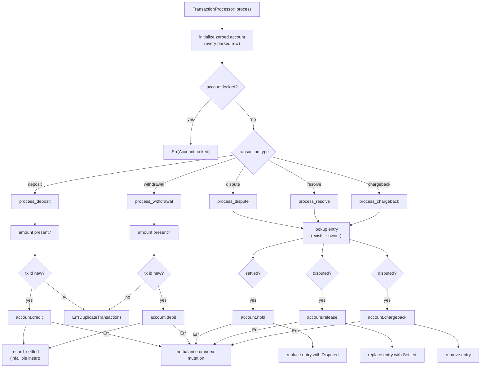

## Context

`TransactionProcessor` is the per-worker ledger state machine. Its public surface is `process`, `accounts`, and `snapshot`; internally it owns a client-to-`Account` map and a transaction-ID-to-`TransactionEntry` map. `process` currently initializes a zeroed account for every parsed row, rejects locked accounts, then routes deposits and withdrawals through one `apply_monetary` helper. That helper performs amount validation, duplicate-ID validation, the balance mutation, and index insertion, and it contains an `unreachable!` arm for non-monetary types. Dispute, resolve, and chargeback each re-fetch the account with `expect` and mutate a `state` field on `TransactionEntry`.

In-force ADRs 0001 (fixed worker-pool sharding) and 0002 (fixed-point `i64` money) still constrain the design: the processor remains worker-local and lock-free, and amount arithmetic stays exclusively in `Account` and `Amount`. ADR 0003 (single-pass streaming) is unaffected because ingestion, queues, snapshot, and shutdown are untouched.

The change is a local data-model and dispatch refactor inside one worker component. A component/data-flow view is enough; a system-context, container, or deployment diagram would not answer a new question.

### Component / data-flow view

## Goals / Non-Goals

**Goals:**

- Make each transaction type's flow readable in one place, without a shared monetary helper that needs an `unreachable!` arm.
- Make settled versus disputed entry state explicit in the entry type.
- Remove infallible-state `expect` calls from the account and entry mutation paths.
- Preserve error precedence, balance arithmetic, index contents, account initialization, and CLI output exactly.
- Make rejection atomicity explicit in the delta spec and cover the reshaped paths with targeted unit tests.

**Non-Goals:**

- Changing the worker pool, dispatcher, pipeline, parser, `Account`, `Amount`, or report code.
- Changing `process`, `accounts`, or `snapshot` signatures.
- Closing the existing gap that duplicate transaction IDs are enforced per worker rather than globally.
- Adding persistence, a new dependency, or any on-disk migration.

## Decisions

### D1. Per-type dispatch after a shared prelude

Keep account initialization and the locked-account check in `process`, then match every `TransactionType` to its own handler: `process_deposit`, `process_withdrawal`, `process_dispute`, `process_resolve`, `process_chargeback`. No handler is reached through another handler, and the monetary `unreachable!` disappears.

- **Rationale:** The prelude is the shared invariant; the match is exhaustive, so each operation's rules stay local and a new transaction type forces an explicit handler rather than silently falling through.
- **Alternatives:** Keep `apply_monetary` and pass a closure/enum for credit versus debit (rejected: still hides two distinct flows); add a monetary trait per type (over-engineered for five variants).

### D2. Preserve the monetary validation sequence

`process_deposit` and `process_withdrawal` each perform, in order: require the amount (`MissingAmount`), reject an existing transaction ID (`DuplicateTransaction`), mutate the balance (`credit` or `debit`), then call `record_settled`. `record_settled` is private, takes the entry fields, and performs only an infallible `HashMap::insert`; it performs no fallible validation after a balance mutation.

- **Rationale:** This keeps the current error precedence (`MissingAmount` before `DuplicateTransaction`) and keeps a duplicate or insufficient-funds rejection from changing balances or overwriting the index.
- **Alternatives:** Validate inside `record_settled` (rejected: a duplicate would be detected after mutation); let `record_settled` return `Result` and roll back (rejected: rollback is harder to audit than check-first).

### D3. Infallible account access after the prelude

The prelude remains the semantic creation point, so a missing-amount row still initializes the client. Handlers obtain the account mutably through `HashMap::entry(...).or_default()` or an equivalent infallible accessor; they do not use `expect`, and they do not treat the accessor as an additional validation step.

- **Rationale:** Account access cannot fail after the prelude, so a panic would be an unreachable invariant violation. An infallible accessor keeps that truth in the type system instead of in an `expect` string.
- **Alternatives:** Keep `get_mut(...).expect("account initialized")` (rejected: leaves a panic path in the refactored code); `get_mut(...).ok_or(WorkerUnavailable)` (rejected: mislabels an internal invariant as infrastructure failure).

### D4. Represent entry state in the entry enum

Replace `TransactionEntry { client, amount, kind, state }` and `EntryState` with:

- `TransactionEntry::Settled { client, amount }`
- `TransactionEntry::Disputed { client, amount }`

`kind` is dropped because no code reads it. State transitions insert a new enum value rather than mutating a field: dispute replaces a validated `Settled` entry with `Disputed`; resolve replaces a validated `Disputed` entry with `Settled`; chargeback removes the validated `Disputed` entry.

- **Rationale:** The state and the fields it requires stay together, invalid combinations cannot be constructed, and transitions become explicit writes instead of a copied value plus a second mutable lookup.
- **Alternatives:** Keep the struct and remove only `kind` (rejected: leaves the mutable-state shape the refactor targets); store amount in a separate map keyed by state (rejected: duplicates indexing and complicates removal).

### D5. Preserve lookup and error precedence

`lookup` continues to reject a missing ID with `UnknownTransaction` and a mismatched owner with `NotOwner` before any state check. Dispute rejects an already disputed entry with `AlreadyDisputed`; resolve and chargeback reject a non-disputed entry with `NotDisputed`. The locked check remains before dispatch, so a locked account reports `AccountLocked` even for a row that would otherwise fail amount validation.

- **Rationale:** These orderings are observable through the unit tests and the accepted/rejected outcome of a row; changing them during a refactor would be an unplanned behavior change.
- **Alternatives:** Reorder checks for “cleaner” handlers (rejected: changes which error wins); collapse `NotDisputed` into `UnknownTransaction` (rejected: loses the distinction and breaks existing tests).

### D6. Test the reshaped paths without rewriting behavior coverage

Existing processor tests assert balances and outcomes, not `TransactionEntry` internals, so they remain valid. Add focused unit tests for missing amount, locked-before-amount precedence, and duplicate rejection followed by a dispute of the original transaction. These prove index non-mutation through an observable balance outcome.

- **Rationale:** The refactor's risk is ordering and mutation placement, so the new tests target exactly those seams while the existing suite guards the rest of the ledger.
- **Alternatives:** Add acceptance scenarios for every internal path (rejected: the delta already carries the observable atomicity scenarios; internal precedence is better covered as unit tests).

## Risks / Trade-offs

- **Validation order drifts while splitting handlers** → D2 and D5 pin the order; dedicated precedence tests fail on drift.
- **A balance mutates before a later error** → every fallible mutation precedes only infallible entry writes; the atomicity scenarios and targeted unit tests fail otherwise.
- **The public entry break surprises library consumers** → the crate is unpublished; the proposal flags the break and no shim is added.
- **Dropping `kind` loses future transaction-type information** → no current reader exists; reintroduce it deliberately if a future feature needs it.
- **`or_default()` masks a broken prelude invariant** → the prelude is unconditional and covered by the rejected-row initialization test; the accessor is documented as infallible access, not validation.
- **Duplicate detection remains worker-local** → unchanged from today; the contract assumes globally unique IDs, and this refactor intentionally does not widen enforcement scope.

## Migration Plan

No data, schema, or output migration. Change `transaction_entry.rs` and `transaction_processor.rs` together, keep the rest of the crate compiling unchanged, then run the acceptance suite plus unit tests, clippy, and fmt. Rollback is a source revert; there is no persisted state to convert.

## Open Questions

- None blocking. The in-force ADRs 0001 and 0002 remain coherent with this design and do not need supersession; the adr step should record that no new durable ADR is required.
